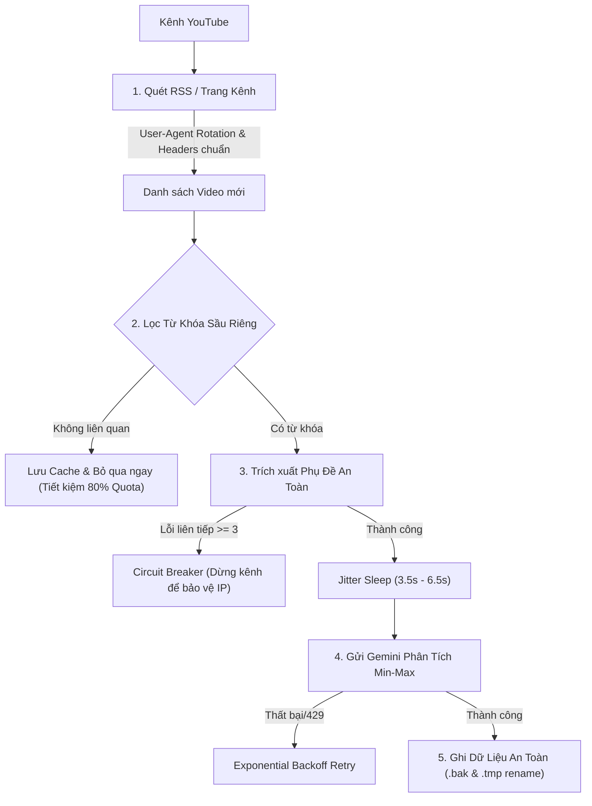

# 🛡️ Cấu Hình & Cơ Chế Cào Dữ Liệu An Toàn (Safe Scraping Architecture)

Tài liệu này mô tả chi tiết toàn bộ các cơ chế và cấu hình bảo vệ được tích hợp trong hệ thống thu thập dữ liệu ([fetch_prices.py](file:///Users/dangvo/Projects/gia-sr/scripts/fetch_prices.py) và [backfill_history.py](file:///Users/dangvo/Projects/gia-sr/scripts/backfill_history.py)).

Mục tiêu cốt lõi: **Đảm bảo thu thập dữ liệu 24/7 ổn định, không bao giờ bị YouTube chặn IP (HTTP 429), không lãng phí Quota Gemini AI và không bao giờ làm hỏng dữ liệu lịch sử**.

---

## 🏗️ 1. Tổng Quan Các Lớp Bảo Vệ (Multi-Layer Protection)



---

## 🔀 2. Xoay Vòng User-Agent & Giả Lập Headers Trình Duyệt Thật

Để tránh việc YouTube nhận diện request từ Python `requests` hoặc GitHub Actions runner:
* Hệ thống trang bị danh sách **Pool User-Agent** của các trình duyệt thật phổ biến nhất hiện nay (macOS Chrome/Safari, Windows Chrome/Firefox, Linux).
* Mỗi request tự động chọn ngẫu nhiên một User-Agent kèm theo đầy đủ các Client Hints headers:
  * `Accept-Language: vi-VN,vi;q=0.9,en-US;q=0.8,en;q=0.7`
  * `Sec-Ch-Ua-Mobile: ?0`
  * `Sec-Fetch-Dest: document`
  * `Upgrade-Insecure-Requests: 1`

```python
USER_AGENTS = [
    "Mozilla/5.0 (Macintosh; Intel Mac OS X 10_15_7) AppleWebKit/537.36 (KHTML, like Gecko) Chrome/122.0.0.0 Safari/537.36",
    "Mozilla/5.0 (Windows NT 10.0; Win64; x64) AppleWebKit/537.36 (KHTML, like Gecko) Chrome/122.0.0.0 Safari/537.36",
    "Mozilla/5.0 (X11; Linux x86_64) AppleWebKit/537.36 (KHTML, like Gecko) Chrome/121.0.0.0 Safari/537.36",
    "Mozilla/5.0 (Macintosh; Intel Mac OS X 14_3_1) AppleWebKit/605.1.15 (KHTML, like Gecko) Version/17.2 Safari/605.1.15",
    "Mozilla/5.0 (Windows NT 10.0; Win64; x64; rv:123.0) Gecko/20100101 Firefox/123.0",
]
```

---

## ⏳ 3. Giãn Cách Ngẫu Nhiên Có Jitter (`safe_sleep`)

Thuật toán chống bot của YouTube dễ dàng phát hiện các request có thời gian nghỉ cố định (ví dụ đúng 5.0 giây). Hệ thống sử dụng cơ chế **Random Jitter Delay**:
* Giữa các video: Nghỉ ngẫu nhiên từ **`3.5s` đến `6.5s`** (`random.uniform(3.5, 6.5)`).
* Khi chuyển giữa các kênh: Nghỉ từ **`4.0s` đến `8.0s`**.
* Cơ chế này mô phỏng hành vi duyệt web tự nhiên của con người, phân tán tải và triệt tiêu nguy cơ bị gắn cờ bot.

---

## 🔁 4. Xử Lý Lỗi 429 & Tự Động Thử Lại (Exponential Backoff)

Khi gặp phản hồi `429 Too Many Requests` hoặc sự cố mạng chập chờn:
* Hàm `safe_requests_get()` tự động kích hoạt chế độ **Exponential Backoff**:
  * Lần 1: Chờ $\sim 10\text{s} + \text{Jitter}$
  * Lần 2: Chờ $\sim 18\text{s} + \text{Jitter}$
  * Lần 3: Chờ $\sim 26\text{s} + \text{Jitter}$
* Nếu sau 3 lần vẫn không thành công, script sẽ ghi log nhẹ nhàng và tiếp tục các video khác, tuyệt đối không spam request liên tục.

---

## 🎯 5. Bộ Lọc Từ Khóa Tiền Xử Lý (Bảo Vệ Quota Gemini AI)

Nhiều kênh nông nghiệp đăng tải xen kẽ video về ớt, mít, phân bón, kỹ thuật tưới tiêu.
* **Trước khi gọi Gemini:** Hệ thống chạy hàm `has_durian_content(title, transcript)`.
* Nếu tiêu đề và 2000 ký tự đầu phụ đề **không chứa từ khóa sầu riêng** (`sầu riêng`, `ri6`, `monthong`, `musang`, `black thorn`, `chuồng bò`, `sáu hữu`, `báo giá xô`,...):
  $\rightarrow$ Video lập tức được đánh dấu `is_price_video: false` vào `processed_videos.json`.
  $\rightarrow$ **Không tốn dù chỉ 1 token Gemini API**, giúp tiết kiệm hơn 80% quota hàng ngày.

---

## ⚡ 6. Bộ Ngắt Mạch Tự Động (Circuit Breaker)

Nếu một kênh bất kỳ gặp lỗi phụ đề liên tiếp **3 lần** (dấu hiệu YouTube đang tạm siết kiểm tra IP hoặc kênh vừa tắt phụ đề hàng loạt):
* Hệ thống kích hoạt **Circuit Breaker**: Lập tức dừng quét kênh đó trong lượt chạy hiện tại.
* Chuyển sang kênh kế tiếp một cách an toàn.
* Ngăn chặn việc IP của runner bị YouTube cấm dài hạn.

---

## 💾 7. Cơ Chế Sao Lưu & Ghi Dữ Liệu Nguyên Tử (Atomic Writes & Backup)

Để phòng ngừa sự cố mất điện hoặc tiến trình bị ngắt đột ngột làm file JSON bị lỗi cú pháp:
1. **Tự động sao lưu (`.bak`):** Trước khi ghi đè dữ liệu mới, file `history.json` hiện tại được copy sang `history.json.bak`.
2. **Atomic Write (`.tmp` $\rightarrow$ rename):** Dữ liệu mới được ghi hoàn chỉnh vào file tạm `history.json.tmp`. Sau khi hoàn tất và kiểm tra tính toàn vẹn mới thực hiện đổi tên (`replace`), đảm bảo file `history.json` luôn luôn nguyên vẹn 100%.

---

## 🔒 8. Khóa Đồng Quy Trên GitHub Actions (Concurrency Control)

Trong file `.github/workflows/update_prices.yml` và `backfill_history.yml`:
* Cấu hình chung nhóm đồng quy:
  ```yaml
  concurrency:
    group: data-pipeline
    cancel-in-progress: false
  ```
* Đảm bảo **chỉ duy nhất 1 tiến trình** cào dữ liệu được chạy tại một thời điểm, tránh tình trạng 2 workflow chạy song song gây xung đột git commit (`merge conflict`).
* Trước khi push code, luôn tự động chạy `git pull --rebase origin main || true` để đồng bộ lịch sử commit mới nhất.
* Thiết lập `timeout-minutes: 25` để tự động hủy nếu có tác vụ bị treo mạng.
